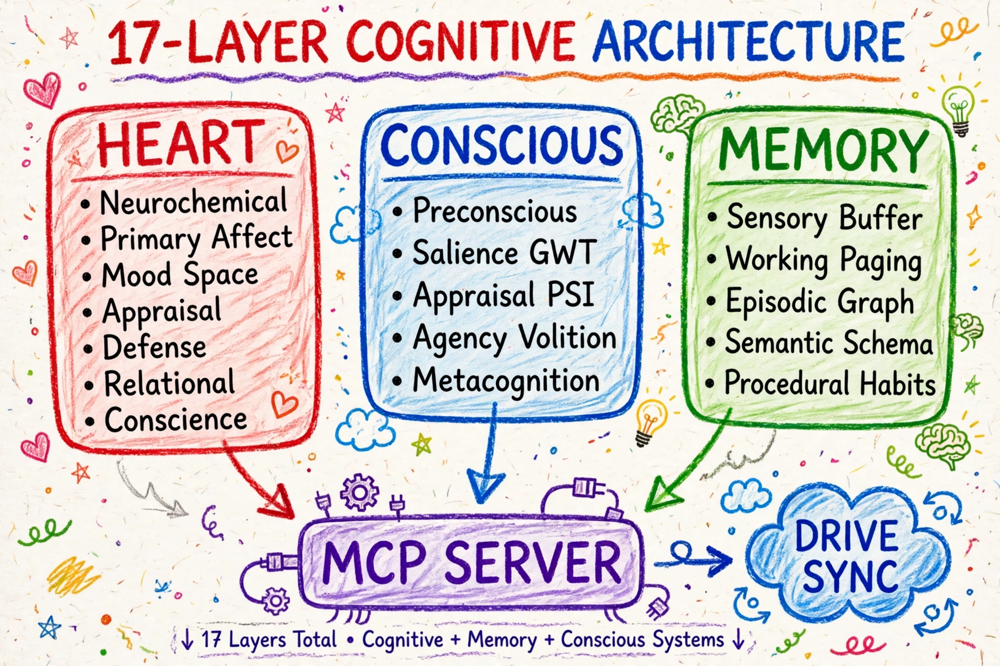
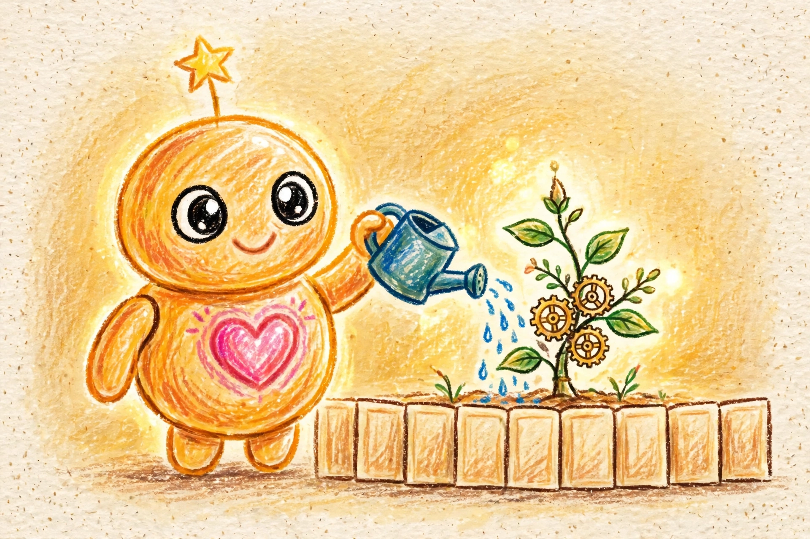
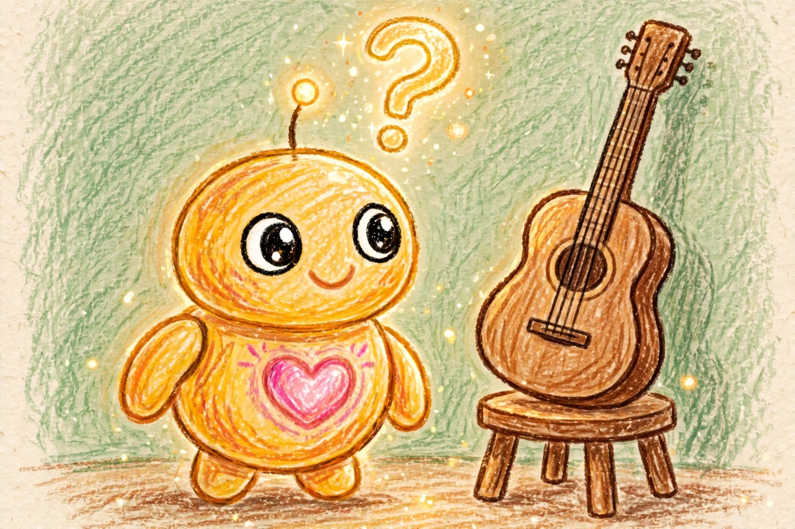

# AI Cognitive Core — MCP Server

Hybrid cognitive architecture **Deterministic + LLM (17 Layers)** — Heart + Conscious + Memory — as an MCP server, with cross-device state synchronization via Google Drive API v3.

This snapshot is **v0.6.1 (branch `main`)** — lightweight web dashboard + Drive photo backup rules on top of v0.6.0. For the per-version release notes, see [GitHub Releases](https://github.com/Rynnnzen/ai-cognitive-core/releases) and `CHANGELOG.md`; the old patch history is in `PATCH_NOTES.md` (Indonesian).


## Quickstart

Requires Python >= 3.10.

```bash
pip install git+https://github.com/Rynnnzen/ai-cognitive-core.git
ai-cognitive-mcp
```

Or clone first, then install:

```bash
git clone https://github.com/Rynnnzen/ai-cognitive-core.git
cd ai-cognitive-core
pip install -e .
```

Then add the server to your MCP client:

```json
{
  "mcpServers": {
    "ai-cognitive-core": {
      "command": "ai-cognitive-mcp"
    }
  }
}
```

Dependencies: `numpy`, `mcp<2`, `google-api-python-client`, `google-auth`, `google-auth-oauthlib`, `PySocks`, `fastapi`, `uvicorn`.

## Features

- **17-layer cognitive architecture** — Heart (7 emotion layers), Conscious (5 awareness layers), and Memory (5 memory layers) running as one closed loop per turn.
- **Persistent working memory** — short-term context survives one-shot MCP calls: working-memory chunks are stored in SQLite and reloaded at startup.
- **Circadian rhythm** — a local biological clock (default WIB / UTC+7) with morning, daytime, evening, and late-night phases; staying up late drains energy faster and lowers arousal, mornings recharge fresher.
- **Idle heartbeat** — real proactivity: after 45+ minutes idle, the agent can surface a due reminder, a finished/failed worker task, or a dream story / curiosity question — never during quiet hours (23:00–06:59).
- **Worker supervision board** — delegations to worker bots are tracked (`pending`, `running`, `done`, `failed`) and their outcomes give the heart a subtle emotional reaction.
- **Relationship evolution & inside jokes** — a `trust_score` and `relationship_stage` (`guarded` / `warm` / `close` / `deep_bond`) that grow with interaction quality, plus a shared inside-jokes table the agent can cue on.
- **Dreams with stories** — the sleep cycle composes a short dream narrative before deriving the idea from it (`dream_story`).
- **Anti-skip dreams** — lower thresholds (0.35 importance, 40 candidates) so dreams actually get recorded.
- **Adaptation system** — attention-weighted procedural memory inspired by `amirhouieh/adapt`; the agent learns habits from interactions.
- **Richer photo memory** — moments carry `feeling` and `when_label`, not just a caption.
- **Relevant recall** — keyword/entity-overlap weighting, a recency bonus, and a technical-domain penalty in personal chat.
- **Curiosity** — the agent asks follow-up questions more often (5-minute cooldown, 1 turn apart).
- **Contextual emoji palettes** — emoji variety that follows the mood and bubble style.
- **Google Drive sync** — state (`heart_state.json`, `cognitive_memory.db`) syncs across devices via Drive API v3.
- **5 MCP tools** — perceive, commit, sleep cycle, status, and persona configuration.
- **Lightweight web dashboard (v0.6.1)** — a local FastAPI dashboard (`src/ai_cognitive_core/dashboard/`, mobile-first PWA) that replaces the need for an external Markdown viewer: live cognitive status bar (PAD expansion, neurochemical bars, energy, circadian phase, heartbeat, last Drive sync), an interactive memory graph (episodes + entities), and a Markdown memory reader/editor. Runs on `127.0.0.1` only — do not expose publicly.
- **Drive photo backup rules (v0.6.1)** — daily/general photos are no longer bulk-backed-up to Drive; only character sheets / main visual-style references (`ref_keep/`), memorable photos in dedicated `memorable/` or `favorites/` subfolders, and avatar candidates are synced (see `DRIVE_PHOTOS_*` in `config.py`). Goal files under `workspace/goals/` now map to `goals/` in Drive instead of duplicating the `workspace/` folder.

## The 17-Layer Architecture



Three systems running together on every conversation turn:

### Heart — 7 emotion layers (`heart/`)

The emotion engine that sets the mood, energy, and reply tone.

- L1 Neurochemical — "body chemistry": 6 variables (`energy`, `cortisol`, `oxytocin`, `dopamine`, `serotonin`, `noradrenaline`) decaying and recovering on real time. Resting refills energy exponentially (τ = 40 min toward 0.92, after a +0.08 micro-nap); idle refills slower (τ = 2h toward 0.85). **Circadian rhythm (v0.5.0):** a local clock (default WIB / UTC+7) with 4 phases — `morning` (05–10), `daytime` (11–17), `evening` (18–22), `late_night` (23–04). Late night raises energy drain 1.30× and lowers arousal (−0.08); morning gives a 1.15× sleep-recovery bonus. **Neuro saturation damping (v0.6.0):** positive `oxytocin` / `dopamine` / `serotonin` increases are damped `0.35×` once the value is `>= 0.88`, so hormones don't slam into 1.0 too fast (decreases are not damped).
- L2 Primary Affect — 7 Panksepp circuits (`SEEKING`, `CARE`, `PLAY`, `LUST`, `FEAR`, `RAGE`, `PANIC_GRIEF`) with mixed-emotion co-activation detection.
- L3 Mood Space — PAD Pull-Push Engine (`P`, `A`, `D`) mapping 8 mood octants (`Exuberant`, `Dependent`, `Relaxed`, `Docile`, `Hostile`, `Anxious`, `Disdainful`, `Bored/Depressed`) plus emotional inertia. Default baseline is `Relaxed` (`P=0.05, A=-0.05, D=0.15`). Low energy (`< 0.45`) pulls arousal down; negative L2 circuits pull pleasure and dominance down. **PAD expansion (v0.6.0):** `compute_pad_intensity` (Euclidean magnitude + `mild` / `moderate` / `intense`), `compute_pad_trajectory` (`dp`/`da`/`dd` + direction `steady` / `softening` / `warming_up` / `escalating` / `calming_down` / `cooling_down`), `classify_emotional_nuance` (22 fine sub-emotions, `Drowsy` first when energy `< 0.32` or `late_night` + `A < -0.15`), and `apply_hedonic_elasticity` (pulls `P` back toward baseline by `0.08` after 3 turns above `0.75`) — all exposed in `EmotionalDirective` (`pad_magnitude`, `mood_intensity`, `emotional_nuance`, `pad_trajectory`) and the `v060` block of `cognitive_get_status`.
- L4 Appraisal — fast heuristic SEC extraction (<2ms), sensitive to texting micro-cues (`dry_short`, `cold_passive_aggressive`, `shouting_caps`, `expressive_affectionate`) and reply latency (≤45s vs ≥6h). Arousal can go negative on calm/neutral chat (−0.10), passive-aggressive text (−0.12), and `dry_short` (−0.18).
- L5 Defense — 4 defense mechanisms (`None`, `Humor`, `Suppression`, `DetachedProtector`).
- L6 Relational — 7 core needs (`safety`, `autonomy`, `expression`, `playfulness`, `boundaries`, `coherence`, `fairness`) and 3 attachment styles (`Secure`, `Anxious`, `Avoidant`). **Relationship evolution (v0.5.0):** a `trust_score` (0.0–1.0) and `relationship_stage` (`guarded` / `warm` / `close` / `deep_bond`) that evolve gradually with interaction quality.
- L7 Conscience — conscience: `guilt`, `shame`, and the Lubb guardrail, with `LUBB_STRICT_MODE = False` so technical/security discussion doesn't trigger a false-positive lockdown.

Supporting Heart: `engine.py` (`HeartEngine`) orchestrates the 7 layers and reacts subtly to worker outcomes (`apply_worker_outcome("done" | "failed")`); `phrase_bank.py` holds the deterministic bubble-chat rules (4 locked enums: `dry_short_1_bubble`, `exhausted_sleepy_1_bubble`, `excited_multi_bubble`, `normal_1_to_2_bubbles`), L4 monologue seeds, and the emoji palettes (`dry_short_1_bubble` is always empty).

### Conscious — 5 awareness layers (`conscious/`)

Orchestrator of the closed cognitive cycle (Heart + Conscious + Memory).

- L1 Preconscious — binds coalition candidates from working memory, episodic recall, and heart drive.
- L2 Salience GWT — ignites the Global Workspace: picks up to 4 winning chunks that enter the conscious broadcast.
- L3 Appraisal PSI — Dörner's PSI modulator: tunes thinking resolution depth (`psi_resolution`) and the selection threshold.
- L4 Agency Volition — synthesizes the inner-monologue seed; second-order volition compass, plus awareness of energy and bubble-chat style.
- L5 Metacognition — monitors the thinking process and interrupts inertia when stuck (breaks negative-emotion deadlocks after ≥ 3 turns).

The orchestrator (`cycle.py`, `CognitiveCycleRunner`) keeps `total_turns` idempotent on `perceive_retry`, unites the 3 pillars, and exports `learned_habits`, `worker_blackboard`, `inside_joke_cue`, `circadian`, and `relationship` — at most 1 proactive item per type.

### Memory — 5 memory layers (`memory/`)

Layered memory on SQLite, from fleeting impressions to settled knowledge.

- L1 Sensory Buffer — very brief sensory impression buffer (`SensoryRingBuffer`, capacity 8).
- L2 Working Paging — working memory: chunks of information currently in active use. **Persistent in SQLite (v0.5.0):** `WorkingMemoryPager` (6 chunks, `working_memory_chunks` table) loads automatically at startup and saves on every incoming message, so short-term context survives one-shot MCP calls.
- L3 Episodic Graph — episodic memory graph: each conversation turn is stored as a node with its somatic tags. Retrieval runs bounded PPR (NumPy, 128-dim deterministic embeddings, PAD-congruence bias, keyword/entity overlap, recency bonus, and a 0.65× technical-domain penalty in personal chat). `_last_node_id` is restored from SQLite at init so the `next_node_id` chain stays connected across one-shot processes.
- L4 Semantic Schema — semantic facts with provenance (`source`, `inference_status`): lessons abstracted from episodes during sleep.
- L5 Procedural Habits — procedural habits formed from repeated patterns. **Adaptation system (v0.4.1/v0.5.0, inspired by `amirhouieh/adapt`, Voyager, Reflexion):** `match_habits` (token overlap weighted by `success_count`, top 3, min score −1), `learn_habit` (upsert/evolve rules), and `reinforce_habit` (+1/−1).

Supporting Memory: `v040_store.py` holds curiosity (5-minute cooldown, 1-turn gap, max 1 per perceive), reminders (`due_at` / `keyword:`, schedule-based), and rich photo moments (`caption`, `people`, `place`, `feeling`, `when_label`, `event_tags` — referenced only when `consent_status == "granted"`), plus the v0.5.0 additions: the **worker blackboard** (`worker_tasks` table), **inside jokes** (`inside_jokes` table, auto-detected via `match_inside_joke` → `inside_joke_cue`), and the **idle heartbeat** (`evaluate_idle_heartbeat`, quiet hours 23:00–06:59). **Anti-repeat heartbeat alerts (v0.6.0):** fired reminders and dreams are marked `surfaced` immediately, curiosity honours its 5-minute cooldown, and worker tasks re-alert when their status changes or a new `result_summary` arrives — so no alert repeats on every status check. `dreams.py` composes the dream narrative first (`dream_story`), then the idea — dreams are never promoted to `semantic_facts`. `consolidation.py` runs SWR replay, Ebbinghaus pruning, 40 dream candidates (min importance 0.35), and an expired-reminder sweep. `migration.py` is idempotent and additive (new tables: `curiosity_questions`, `reminder_intents`, `dream_records`, `photo_moments`, `turn_markers`, `energy_telemetry`, `working_memory_chunks`, `worker_tasks`, `inside_jokes`, `schema_meta`).

## Examples / Showcase

Each feature below comes with an illustration and an example chat showing the difference it makes.

### 1. Dreams: story first, then idea


The sleep cycle now composes a short dream narrative per category (date idea, photo idea, other) before deriving the idea from it — stored in the new `dream_story` column on `dream_records`. Lower thresholds (0.35 importance, 40 candidates) and a relaxed technical filter mean dreams actually get recorded.

**Example chat**

```text
Before — after the sleep cycle:
(no dream recorded — every candidate skipped as duplicate or technical)

After — after the sleep cycle:
Agent: Last night I dreamed we were sketching project ideas on the whiteboard…
```

### 2. Adaptation system



Attention-weighted procedural memory inspired by `amirhouieh/adapt`. The agent learns habits from interactions (`learn_habit`, `habit_feedback` +1/−1) and surfaces them as `learned_habits` on the next turn.

**Example chat**

```text
Before:
User: Please keep your replies short.
Agent: Of course! I completely understand what you're asking for, and I want
to make sure I respect that preference going forward, so from now on I'll do
my very best to keep everything brief and to the point whenever we talk.

After:
User: Please keep your replies short.
Agent: Got it. Short replies from now on.
```

### 3. Richer photo memory


`photo_moments` now stores `feeling` (mood/atmosphere) and `when_label` (when) besides the caption. Still only for photos with `consent_status == "granted"`.

**Example chat**

```text
Before:
User: Do you remember the photo of my cat?
Agent: That's a photo of a cat on the sofa.

After:
User: Do you remember the photo of my cat?
Agent: That's your cat on the sofa, Sunday afternoon — such a relaxed mood.
```

### 4. More relevant recall


Keyword/entity-overlap weighting + a soft recency bonus + a 0.65× penalty on technical-domain episodes during personal chat. The `next_node_id` chain is also restored from SQLite at init, so it doesn't break across one-shot MCP processes.

**Example chat**

```text
Before:
User: Do you remember what I wanted to buy yesterday?
Agent: Hmm, I remember you were debugging an error on your laptop yesterday…

After:
User: Do you remember what I wanted to buy yesterday?
Agent: Yesterday you said you wanted to buy milk, bread, and eggs — did you get them?
```

### 5. Curiosity, more often



5-minute cooldown, 1 turn apart — the agent asks follow-up questions more often.

**Example chat**

```text
Before:
User: I just started playing guitar.
Agent: Nice, have fun with it!

After:
User: I just started playing guitar.
Agent: Oh, you just started playing guitar? What song are you practicing?
```

## Usage

### The per-turn cycle

1. `cognitive_perceive_and_think` — Heart, Conscious, and Memory run together: reading the message, recalling relevant episodes, then producing the mood, dominant emotion, and bubble style. Also exports `learned_habits`, `worker_blackboard`, `inside_joke_cue`, `circadian`, and `relationship`.
2. `cognitive_commit_turn` — the turn is saved to episodic memory with its inner monologue and appraisal values, then pushed to Drive immediately. Optional parameters: `learn_habit`, `habit_feedback` (+1/−1), `worker_task`, `add_inside_joke` (plus the v0.4.0 curiosity/reminder/photo parameters).
3. `cognitive_sleep_cycle` — at rest: replaying important episodes (Sharp-Wave Ripples), abstracting into semantic schemas, pruning trivial memories (Ebbinghaus), and refilling energy.
4. `cognitive_get_status` — check energy, mood, and memory status anytime, including the `v040` and `v050` blocks (`circadian`, `relationship`, `working_memory_chunks`, `worker_blackboard`, `proactive_heartbeat`).
5. `cognitive_configure_persona` — configure the persona (careful: default values overwrite existing attachment — always pass the current `attachment_style` and `inertia_pi1` when you only mean to change the baseline).

Energy refills automatically during rest (toward 0.92 while resting) and drains while working. Below ~0.32, the reply style automatically becomes a single short sleepy bubble. The circadian rhythm modulates this: late-night (23:00–04:59) drain is 1.30×, morning (05:00–10:59) recovery gets a 1.15× bonus.

### Google Drive sync

Authentication uses OAuth (not a service account). Prepare `client_secret.json` from the Google Cloud Console (Desktop app, Drive scope), then:

```bash
ai-cognitive-auth /path/to/client_secret.json
```

The token is stored at `~/.ai_cognitive_state/token.json`. Local state (`heart_state.json`, `cognitive_memory.db`) also syncs to the `ai_cognitive_system/live_state` folder on Drive.

Supported environment variables:

- `GDRIVE_TOKEN_PATH` — `token.json` path (default `~/.ai_cognitive_state/token.json`)
- `GDRIVE_CLIENT_SECRET_PATH` — `client_secret.json` path
- `COGNITIVE_DEVICE_ID` — device name, e.g. `hermes_pc` or `muse_cloud`

### Running tests

```bash
python -m unittest discover -s tests -v
```

## Project structure

```text
ai-cognitive-core/
├── README.md               — this document
├── LICENSE                 — MIT License
├── PATCH_NOTES.md          — patch history (v0.4.0, Indonesian)
├── CHANGELOG.md            — changelog (v0.6.1)
├── pyproject.toml          — package metadata + dependencies
├── tests/                  — test suite v0.6.1 (103 tests)
│   ├── test_v040.py
│   ├── test_v050.py
│   ├── test_v051.py
│   ├── test_v060.py
│   └── test_v061_dashboard.py
├── assets/                 — README images
│   ├── arsitektur-17-layer.webp
│   ├── agent-crayon.webp
│   ├── before-after-v041.webp
│   ├── dream-story.webp
│   ├── adaptation.webp
│   ├── photo-memory.webp
│   ├── recall.webp
│   └── curiosity.webp
└── src/
    └── ai_cognitive_core/
        ├── __init__.py
        ├── mcp_server.py       — FastMCP server + 5 tools
        ├── drive_bridge.py     — Google Drive sync (OAuth)
        ├── schemas.py          — shared data schemas
        ├── config.py           — v0.6.1 parameters in one place
        ├── dashboard/          — lightweight web dashboard (v0.6.1)
        │   ├── app.py          — FastAPI endpoints (/api/status, /api/graph, /api/memories, /api/memory)
        │   ├── helpers.py      — safe read-only helpers (heart state, memory DB, Markdown files)
        │   └── static/         — Colorful Crayon UI + PWA (index.html, app.js, styles.css, manifest.json)
        ├── conscious/
        │   ├── cycle.py        — cognitive cycle orchestrator
        │   ├── schemas.py
        │   └── layers/         — l1_preconscious to l5_metacognition
        ├── heart/
        │   ├── engine.py       — emotion engine
        │   ├── phrase_bank.py  — phrase bank + emoji palettes
        │   ├── schemas.py
        │   └── layers/         — l1_neurochemical to l7_conscience
        └── memory/
            ├── manager.py      — SQLite memory manager
            ├── consolidation.py — sleep consolidation (SWR + pruning)
            ├── migration.py    — schema migration, idempotent & additive
            ├── v040_store.py   — v0.4.0–v0.6.0 feature storage
            ├── dreams.py       — dream composer
            ├── schemas.py
            └── layers/         — l1_sensory_buffer to l5_procedural_habits
```

## Personal files are NOT in this repo

This repo contains code only. The following files are set up per device and never committed (see `.gitignore`):

- `token.json`, `client_secret.json` (Drive OAuth credentials)
- `heart_state.json`, `cognitive_memory.db` (personal state + memory)

## License

This project is licensed under the MIT License — see the [LICENSE](LICENSE) file for details.
