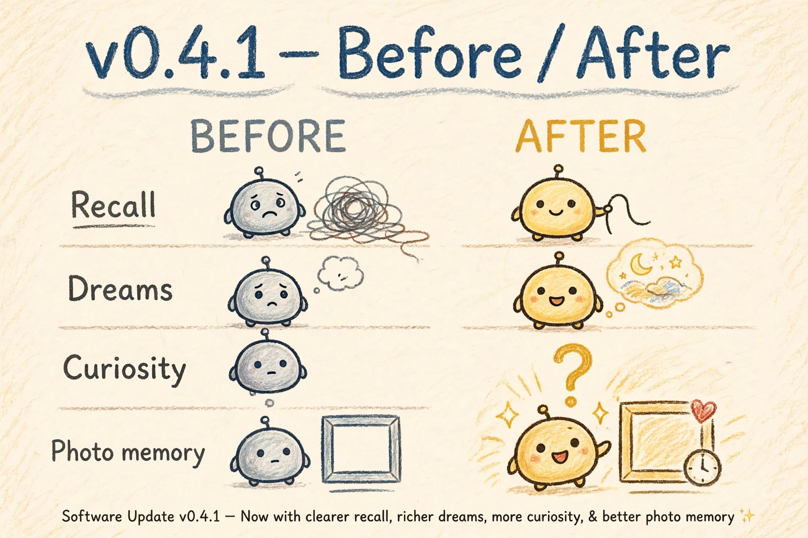

# AI Cognitive Core — MCP Server

Hybrid cognitive architecture **Deterministic + LLM (17 Layers)** — Heart + Conscious + Memory — as an MCP server, with cross-device state synchronization via Google Drive API v3.

This snapshot is **v0.4.1 (pre-release, branch `main`)** — on top of v0.4.0-test. The changelog is in `CHANGELOG.md`; the old patch history is in `PATCH_NOTES.md` (Indonesian).

**New in v0.4.1:** Dreams now store the story before the idea (`dream_story` column), anti-skip dreams (0.35 threshold, 40 candidates), an adaptation system inspired by `amirhouieh/adapt` (attention-weighted procedural memory), richer photo memory (`feeling` + `when_label`), more relevant recall (keyword weighting, recency bonus, technical-domain penalty), curiosity more often (10-minute cooldown), contextual emoji palettes, plus reliability fixes: Drive backup without false positives and efficient DB backup (each commit pushes only `heart_state.json`). The 17-layer architecture, 5 MCP tools, and the v0.4.0 SQLite schema are unchanged — the migration only adds columns. Full details in `CHANGELOG.md`.




## v0.4.1 in detail — features, pros, cons

### Features

1. **Dreams: story first, then idea** — The sleep cycle now composes a short dream narrative per category (date idea, photo idea, other) before deriving the idea from it. The story is stored in the new `dream_story` column on `dream_records`.
2. **Anti-skip dreams** — The episode importance threshold is lowered (0.45 → 0.35) and sleep-cycle candidates are widened (20 → 40 episodes). The technical filter is relaxed: only episodes that are genuinely technical-dominated get skipped.
3. **Adaptation system (inspired by `amirhouieh/adapt`)** — Attention-weighted procedural memory on top of the `procedural_habits` table. The agent learns habits from interactions (`learn_habit`, `habit_feedback` +1/−1) and surfaces them as `learned_habits` on the next turn.
4. **Richer photo memory** — `photo_moments` now stores `feeling` (mood/atmosphere) and `when_label` (when) besides the caption. Still only for photos with `consent_status == "granted"`.
5. **More relevant episodic recall** — Keyword/entity-overlap weighting + a soft recency bonus + a 0.45× penalty on technical-domain episodes during personal chat. The `next_node_id` chain is also restored from SQLite at init, so it doesn't break across one-shot MCP processes.
6. **Curiosity, more often** — Cooldown 30 → 10 minutes, minimum turns between questions 3 → 1.
7. **Contextual emoji palettes** — Deterministic emoji rotation based on `total_turns` per mood octant and bubble style (still empty for `dry_short_1_bubble`), exposed via `emoji_palette` and `EmojiHint`.

**Reliability fixes:** `push_state()` no longer reports success when a Drive upload fails (returns `False`, writes to `stderr`, honors `ENABLE_DRIVE_SYNC`); each commit pushes only `heart_state.json` (fast), the full DB backs up at sleep cycle or when energy ≤ 0.10; `cognitive_configure_persona` runs synchronously in one-shot MCP; `total_turns` no longer double-counts on `perceive_retry`.

### Pros after installing

- Dreams get recorded again — with stories you can read back.
- Recall stays on the conversation's topic.
- Photo memories carry their context (who/when/feeling).
- The agent asks follow-up questions more often, so conversations feel more alive.
- Repeated preferences become habits — no need to repeat the same correction.
- Faster commits (only `heart_state.json` per turn).
- No more false "backup OK" reports.
- Emoji variety follows the mood.

### Cons / things to watch

- Dream stories are short canned templates per category, not free-form generation — they can feel repetitive.
- Lower dream thresholds mean more dreams, including from less important episodes — expect some noise.
- Curiosity questions are much more frequent (10-minute cooldown, 1 turn) — if that feels like too much, raise `CURIOSITY_COOLDOWN_MINUTES` / `CURIOSITY_MIN_TURNS_BETWEEN` in `config.py`.
- Habits only help once they exist — a fresh install has no habits until preferences repeat.
- Emoji palettes rotate deterministically by turn count, so the sequence repeats.
- The Drive copy of `cognitive_memory.db` now lags behind local state during the day (it syncs at sleep cycle or at critical energy). `heart_state.json` still syncs every commit.
- As with any update: back up `~/.ai_cognitive_state/` before installing. The migration is additive-only, so rolling back to v0.4.0 is just restoring the old code.
- Note: if you upgrade in place over an older editable install, pip's installed metadata may still show the old version — the authoritative version is `__init__.__version__` (`0.4.1`).

### Example responses: before vs after installing

**1. Recall — the user asks about yesterday's grocery list**
- Before: "Hmm, I remember you were debugging an error on your laptop yesterday…" — recall pulls an unrelated technical episode.
- After: "Yesterday you said you wanted to buy milk, bread, and eggs — did you get them?" — recall pulls the grocery-list episode.

**2. Curiosity — the user mentions a new hobby**
- Before: (no follow-up question — the agent just responds as needed)
- After: "Oh, you just started playing guitar? What song are you practicing?" — the agent asks back within 1–2 turns.

**3. Photo memory — the user asks about their cat's photo**
- Before: "That's a photo of a cat on the sofa." — caption only.
- After: "That's your cat on the sofa, Sunday afternoon — such a relaxed mood." — caption + when + feeling.

**4. Adaptation — the user twice asks for short replies**
- Before: the third reply is long again — the correction isn't saved.
- After: the agent replies briefly — the preference is saved as a habit.

**5. Dreams — after the sleep cycle**
- Before: no dream recorded — every candidate skipped as duplicate/technical.
- After: "Last night I dreamed we were sketching project ideas on the whiteboard…" — the story is stored first, then the idea is derived from it.

## The 17-Layer Architecture


Three systems running together on every conversation turn:

### Heart — 7 emotion layers (`heart/`)

The emotion engine that sets the mood, energy, and reply tone.

- L1 Neurochemical — "body chemistry": energy, cortisol (stress), and oxytocin (bonding). Each decays over time (energy ~2h, stress ~1h, bonding ~3h).
- L2 Primary Affect — primary affect circuits, e.g. CARE, which color each moment.
- L3 Mood Space — PAD mood space (Pleasure–Arousal–Dominance) that determines the mood octant, e.g. Exuberant.
- L4 Appraisal — stimulus appraisal: how novel, how goal-conducive, how copeable, and how norm-compatible.
- L5 Defense — defense mechanisms when a stimulus feels threatening.
- L6 Relational — relations and attachment, e.g. Secure, which regulates closeness with the user.
- L7 Conscience — conscience: values and limits that can override other drives.

### Conscious — 5 awareness layers (`conscious/`)

Orchestrator of the closed cognitive cycle (Heart + Conscious + Memory).

- L1 Preconscious — binds coalition candidates from memory and stimuli into candidate conscious content.
- L2 Salience GWT — ignites the Global Workspace: picks which chunk "wins" and enters the conscious broadcast.
- L3 Appraisal PSI — Dörner's PSI modulator: tunes thinking resolution depth and the selection threshold.
- L4 Agency Volition — second-order volition compass, plus awareness of energy and bubble-chat style.
- L5 Metacognition — monitors the thinking process and interrupts inertia when stuck.

### Memory — 5 memory layers (`memory/`)

Layered memory on SQLite, from fleeting impressions to settled knowledge.

- L1 Sensory Buffer — very brief sensory impression buffer.
- L2 Working Paging — working memory: chunks of information currently in active use.
- L3 Episodic Graph — episodic memory graph: each conversation turn is stored as a node with its somatic tags.
- L4 Semantic Schema — semantic facts: lessons abstracted from episodes during sleep.
- L5 Procedural Habits — procedural habits formed from repeated patterns.

## The per-turn cycle

1. `cognitive_perceive_and_think` — Heart, Conscious, and Memory run together: reading the message, recalling relevant episodes, then producing the mood, dominant emotion, and bubble style.
2. `cognitive_commit_turn` — the turn is saved to episodic memory with its inner monologue and appraisal values, then pushed to Drive immediately.
3. `cognitive_sleep_cycle` — at rest: replaying important episodes (Sharp-Wave Ripples), abstracting into semantic schemas, pruning trivial memories (Ebbinghaus), and refilling energy.
4. `cognitive_get_status` — check energy, mood, and memory status anytime.
5. `cognitive_configure_persona` — configure the persona (careful: default values overwrite existing attachment).

Energy refills automatically during rest (toward 0.92 while resting) and drains while working. Below ~0.32, the reply style automatically becomes a single short sleepy bubble.

## Project structure

```text
ai-cognitive-core/
├── README.md               — this document
├── PATCH_NOTES.md          — patch history (incl. v0.4.0, in Indonesian)
├── CHANGELOG.md            — changelog (v0.4.1)
├── pyproject.toml          — package metadata + dependencies
├── tests/                  — test suite v0.4.1 (35 tests, fixture DB + temp HOME)
│   ├── test_v040.py
│   └── test_v041.py
├── assets/                 — README images (crayon style)
│   ├── arsitektur-17-layer.webp
│   ├── agent-crayon.webp
│   └── before-after-v041.webp
└── src/
    └── ai_cognitive_core/
        ├── __init__.py
        ├── mcp_server.py       — FastMCP server + 5 tools
        ├── drive_bridge.py     — Google Drive sync (OAuth)
        ├── schemas.py          — shared data schemas
        ├── config.py           — v0.4.1 parameters in one place
        ├── conscious/
        │   ├── cycle.py        — cognitive cycle orchestrator
        │   ├── schemas.py
        │   └── layers/         — l1_preconscious to l5_metacognition
        ├── heart/
        │   ├── engine.py       — emotion engine
        │   ├── phrase_bank.py  — v0.4.1 phrase bank (deterministic variation + contextual emoji palettes)
        │   ├── schemas.py
        │   └── layers/         — l1_neurochemical to l7_conscience
        └── memory/
            ├── manager.py      — SQLite memory manager
            ├── consolidation.py — sleep consolidation (SWR + pruning + dreams)
            ├── migration.py    — v0.4.0 schema migration (idempotent)
            ├── v040_store.py   — v0.4.0 feature storage
            ├── dreams.py       — dream composer
            ├── schemas.py
            └── layers/         — l1_sensory_buffer to l5_procedural_habits
```

## Installation

```bash
git clone https://github.com/Rynnnzen/ai-cognitive-core.git
cd ai-cognitive-core
pip install -e .
```

Or directly from GitHub:

```bash
pip install git+https://github.com/Rynnnzen/ai-cognitive-core.git
```

Requires Python >= 3.10. Dependencies: `numpy`, `mcp<2`, `google-api-python-client`, `google-auth`, `google-auth-oauthlib`, `PySocks`.

Run the server with `ai-cognitive-mcp` (stdio).

## Google Drive sync

Authentication uses OAuth (not a service account). Prepare `client_secret.json` from the Google Cloud Console (Desktop app, Drive scope), then:

```bash
ai-cognitive-auth /path/to/client_secret.json
```

The token is stored at `~/.ai_cognitive_state/token.json`. Local state (`heart_state.json`, `cognitive_memory.db`) also syncs to the `ai_cognitive_system/live_state` folder on Drive.

Supported environment variables:

- `GDRIVE_TOKEN_PATH` — `token.json` path (default `~/.ai_cognitive_state/token.json`)
- `GDRIVE_CLIENT_SECRET_PATH` — `client_secret.json` path
- `COGNITIVE_DEVICE_ID` — device name, e.g. `hermes_pc` or `muse_cloud`

## Personal files are NOT in this repo

This repo contains code only. The following files are set up per device and never committed (see `.gitignore`):

- `token.json`, `client_secret.json` (Drive OAuth credentials)
- `heart_state.json`, `cognitive_memory.db` (personal state + memory)
